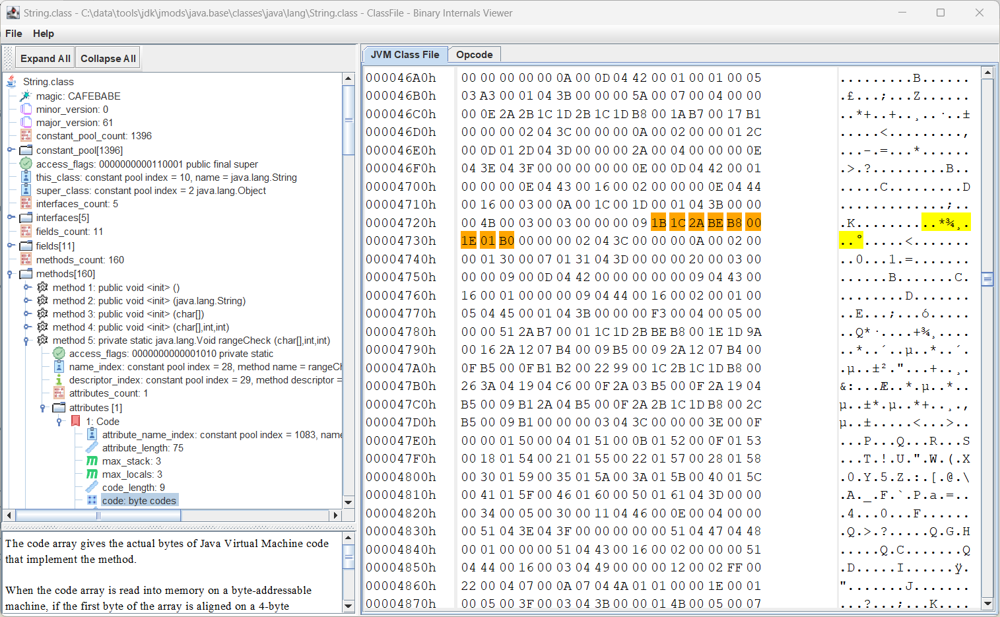
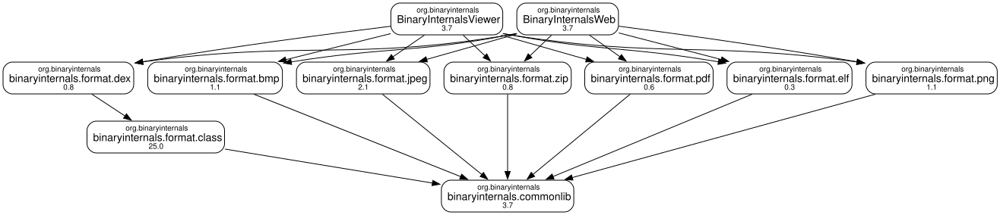

## Binary Internals Viewer

An application to show binary file internals visually & interactively for the meaning of every bit.

Supported Formats

* [BMP](https://en.wikipedia.org/wiki/BMP_file_format) file
* [Class](https://docs.oracle.com/javase/specs/) file
  * Programming Logic: http://www.codeproject.com/Articles/35915/Java-Class-Viewer
  * Usage Sample: https://www.codeproject.com/Articles/762980/Inside-the-Hello-World-Application-via-Java-Class
* [JPEG](https://en.wikipedia.org/wiki/JPEG) file
* [PNG](https://en.wikipedia.org/wiki/Portable_Network_Graphics) file
* [ZIP](https://en.wikipedia.org/wiki/ZIP_(file_format)) file
  * [The structure of a PKZip file](https://users.cs.jmu.edu/buchhofp/forensics/formats/pkzip.html)
* Will supported formats
  * [DEX](https://en.wikipedia.org/wiki/Dalvik_(software)) file for Android (in progress)
  * [ELF](https://en.wikipedia.org/wiki/Executable_and_Linkable_Format) file for `*nix` systems (in progress)
 
Sample

* Here is a screen shot opening `java.lang.String.class` file

Download

* Download Application: https://github.com/amosshi/binaryinternals/releases

User guide

* We need the `java` command to run this tool
  * `java -jar BinaryInternalsViewer-3.7-timestamp.jar`
    * Where `timestamp` is the auto-generated build timestamp
  * Menu item: `File` > `Open...`
  * Choose the binary file to view

Web Server and API

* The `BinaryInternalsWeb` module provides the same file view in a web page, and an HTTP API, using the same format plug-ins
* Run with Docker, from the repository root
  * `docker build -f BinaryInternalsWeb/Dockerfile -t binaryinternals-web .`
  * `docker run --rm -p 8080:8080 --read-only --tmpfs /tmp --memory 512m --cpus 1 binaryinternals-web`
  * Open http://localhost:8080
* Run with Docker Compose, from the repository root
  * `docker compose -f BinaryInternalsWeb/docker-compose.yml up -d --build`, settings in [docker-compose.yml](BinaryInternalsWeb/docker-compose.yml)
  * `docker compose -f BinaryInternalsWeb/docker-compose.yml down` to stop
* Run without Docker, after `mvn install`
  * `java -jar BinaryInternalsWeb/target/BinaryInternalsWeb-3.7.jar`
  * Or, as a Java module: `java -p BinaryInternalsWeb/target/libs:BinaryInternalsWeb/target/BinaryInternalsWeb-3.7.jar -m org.binaryinternals.web/org.binaryinternals.web.WebServer`
* API
  * `GET /api/v1/formats` - the supported formats and file extensions
  * `POST /api/v1/parse?name=Foo.class` - the request body is the file content, the response is the JSON tree of the file
    * `curl --compressed --data-binary @Foo.class "http://localhost:8080/api/v1/parse?name=Foo.class"`
    * Each node: `{"text": "magic: CAFEBABE", "start": 0, "length": 4, "icon": "Magic", "description": "...", "children": [...]}`
    * `icon`, `description` and `children` are left out when absent; `description` is HTML
    * Errors: `{"status": 415, "error": "..."}` with status `400`, `405`, `413` (too large), `415` (unsupported type), `422` (invalid file), `503` (busy), `504` (timeout)
  * `GET /health` - health check
  * Uploaded files are only kept in a temporary file during the parsing
* Settings, by environment variables
  * `HOST` (default `127.0.0.1`, `0.0.0.0` in Docker), `PORT` (default `8080`)
  * `MAX_UPLOAD_MB` (default `20`), `MAX_CONCURRENT_PARSES` (default: number of processors), `PARSE_TIMEOUT_SECONDS` (default `30`)
  * `CORS_ORIGIN` (default `*`, empty to disable)

Build the Source Code

* Prerequisite
  * Java Version: `OpenJDK version 11` or higher
  * Set `JAVA_HOME` environment variable
    * If not set use the export statements in the `build.sh` script
  * Build Tool: `Apache Maven 3.6` or higher: because we are using the [Maven CI Friendly Versions](https://maven.apache.org/maven-ci-friendly.html) `${revision}` feature
* MacOS need to install the Linux style commands
  * `brew install coreutils`
  * `brew install parallel`
  * `brew install graphviz`
* Build
  * `./build.sh` (Linux/MacOS/Windows Git Bash)
  * `build.cmd` (Windows CMD)

Structure

* This application does not have 3rd party dependency other than JDK, easy to add it to your existing project

`Java Class Viewer`

* The original `Java Class Viewer` has been renamed and merged into `Binary Internals Viewer` since Apr 2021

## Standalone Libs

The `FormatXXXX.jar` files can be used in your project when needed.
